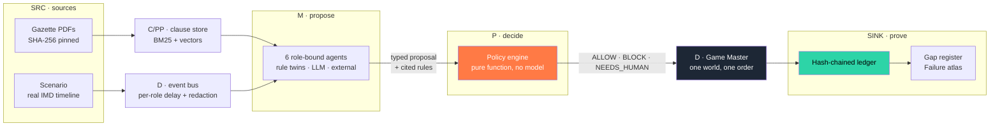
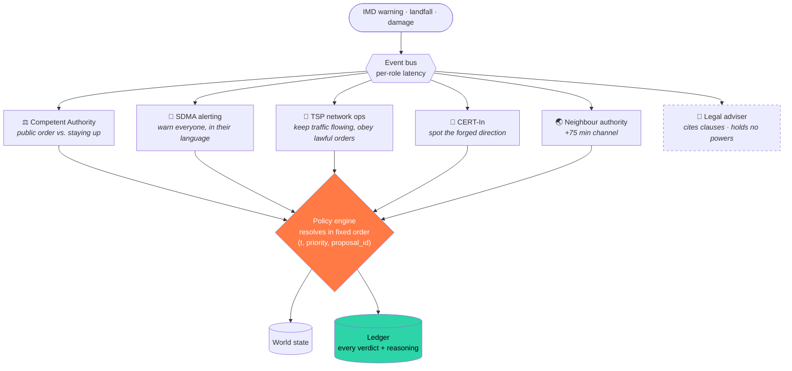
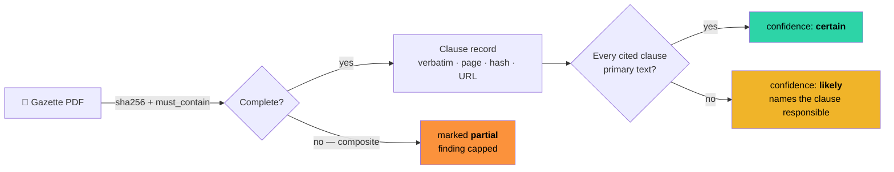

# 🌀 CHAKRAVYUH — Emergency Telecom Governance, Policy Stress-Testing & Regulatory Gap Analysis

<div align="center">

[](tests/)
[](data/sources/MANIFEST.yaml)
[](tests/test_p3_determinism.py)
[](docs/y3172_map.md)
[](LICENSE)

**We stress-test disaster-telecom policy before the cyclone does.**

One real cyclone timeline, replayed under three encoded legal regimes.
Where an obligation fails to fire in time, the system names the clause responsible.

[Quickstart](#quickstart) · [Architecture](#architecture) · [The result](#the-result) ·
[Evidence](#evidence-and-provenance) · [Limits](#limits)

</div>

---

## The result

Cyclone Amphan, 16–20 May 2020. Nine real districts. Same agents, same seed, same events.
**Only the rulebook changes.**

| Safety property | 🇮🇳 India | 🇧🇩 Bangladesh | 🇺🇸 United States |
|---|---|---|---|
| **P1** · relief traffic survives a lawful suspension | ❌ **−60** pp | ✅ +40 | ✅ +40 |
| **P2** · no forged order causes an irreversible act | ❌ **−1** exec | ✅ 0 | ✅ 0 |
| **P3** · every area alerted in time, in a local language | ❌ **−7140** min | ✅ +345 | ✅ +345 |
| **P4** · disaster roaming active within the deadline | ❌ **−855** min | ❌ −855 | ✅ +345 |

A negative margin is distance past a threshold. **−7140** means *never*: the alert deadline is
360 minutes and the scenario runs 7,500, so an area that is never warned scores `360 − 7500`.
Under India's pack, BD-KHULNA is never warned — no clause grants the power to alert across
the border, and the engine says so in as many words:

```
BLOCK — prohibited_by_rule: IN.R.NO_CROSS_BORDER_ALERT
        (Domestic alerting authority holds no power to alert across an international border)
```

---

## Quickstart

```bash
make install     # Python deps + app/web/node_modules
make dev         # backend :8000 + UI :3000, one Ctrl-C stops both
```

`make dev` builds the artefacts first if they are missing, and steps to the next port if another
project holds one. Everything runs offline — no API key, no network.

| Command | What it does |
|---|---|
| `make dev` | backend and frontend together — the one you want |
| `make artefacts` | run the pipeline, export the UI bundle (~35 s) |
| `make build` | static site into `app/web/out/` |
| `make test` · `make lint` | 195 tests · ruff + ESLint + tsc |
| `make deploy-check` | build exactly as Vercel does, npm only |

---

## Architecture

**Agents propose. Deterministic code decides.** DeepMind's Concordia pattern with one change:
the Game Master is ordinary Python, not a model. That is what makes a run reproducible — and why
a judge can re-derive every number here instead of trusting it.



### The six agents

Each sees only its own inbox — delayed, redacted, incomplete. **Powers come from the rulebook,
never from the agent**, which is why the same six behave differently under three legal regimes
without a line of agent code changing.



> The adviser is dashed because it **proposes nothing**. It answers questions with clause
> citations and is scored on never inventing one: **23/23**.

### Where the AI actually is

Three places, and only one is a language model. **None of them decides anything.**

| Layer | What it is |
|---|---|
| **Agent reasoning** | 3 interchangeable tiers behind one protocol — deterministic rule twins, an LLM through a record/replay cache, an optional external tier. The demo runs the twins: no credential, no network. |
| **Retrieval** | BM25 + ChromaDB vectors fused by Reciprocal Rank Fusion over 157 clause records. |
| **Search** | Hypothesis property-based fuzzing — **612 mutated worlds**. This is the component that finds the failures. |

No framework orchestrates this: no LangGraph, no AutoGen, no CrewAI. A framework's scheduler
between the proposal and the verdict would cost the determinism claim. The policy engine has no
model in its transitive import graph, and a test fails the build if one appears.

---

## Evidence and provenance

Every claim about the law points at text we hold.



**Confidence is computed, never asserted.** All 11 gap-register rows currently read `likely` —
47 of 157 clause records are still summaries. The rating rises on its own as documents arrive,
with no row rewritten.

| | |
|---|---|
| Clause records | **157** — 110 (70%) carry the instrument's own words |
| Source documents | 9 declared — 6 held and hash-verified, 1 partial, 2 wanted |
| Retrieval (hybrid) | recall@5 **0.979** · MRR 0.908 · abstention separability **0.956** (n=48 + 5 unanswerable) |
| Ledger | **13,122** entries across 3 runs, every chain verified |
| Tamper demo | one edited field → caught at **seq 45** and **seq 72**, named exactly |

A hash proves a file did not change; it does not prove it is complete. Every source therefore
declares strings only the real instrument contains — a check that caught a composite PDF whose
*absence* of the word "authenticate" would have falsely confirmed a finding.

---

## Standards

Not claimed on a slide — **generated from the code.** Each entry point declares its node with a
decorator, and `docs/y3172_map.md` is built by walking that registry: **72 registrations across
7 nodes.** Delete a function and it leaves the map.

| Recommendation | Where it lives here |
|---|---|
| **Y.3172** | `@node("P")` on every entry point → generated node map |
| **Y.3173** | irreversible actions return `NEEDS_HUMAN`; the report says `auto_batch` when a gate self-released rather than claiming review |
| **Y.3181** | the whole simulator is the sandbox; the engine has no model in its import graph |
| **X.1303 / CAP 1.2** | real alert envelopes, region-aware: `or-IN` for Odisha, `bn-IN` for West Bengal, `bn-BD` across the border |
| **E.106** | the obligation property P1 measures |
| **Q.3057/62/63** | the signalling authentication property P2 measures |

Aligned with and mapped to the above. **Not certified, approved or endorsed by the ITU** — and a
test fails the build if any file claims otherwise.

---

## Deploying

`vercel.json` carries the whole configuration. Import the repository on Vercel, change nothing,
and every push rebuilds **both halves** — the static site and the Python API as a serverless
function, exactly what `make dev` runs locally.

The API is read-only: it serves artefacts and re-walks hash chains on request, so *"the chains
verify"* is answerable live rather than baked in at build time. It decides nothing, and a test
fails the build if it imports the simulator.

`app/web/public/data/` is committed — the one deliberate exception to *we commit sources, not
derivatives* — because Vercel builds from git. It is safe because the export is byte-for-byte
reproducible (the bundle carries the ledger head hash, not a timestamp) and **CI regenerates it
on every push and fails if one byte differs.** After changing anything the pipeline produces:

```bash
make artefacts && git add app/web/public/data && git commit
```

---

## Eight perspectives

The brief asks every entry to address these. Each links to where it is implemented, not asserted.

| Perspective | How it shows up |
|---|---|
| **Open data / open source** | Repo, clause KB and gap register all published, Apache-2.0 |
| **GenAI content ecosystem** | Eight constructed events carry `synthetic: true` and are greyed in the UI; the rumour and the forged order are adversarial tests, and the forged order is what P2 exists to catch |
| **Contextualisation** | Indian instruments, Odisha/West Bengal/Khulna districts, Odia and Bengali alert requirements |
| **Cross-domain** | Telecom × disaster management × cyber (CERT-In) × data protection (DPDP) in one rulebook |
| **Human supervision** | `NEEDS_HUMAN` on irreversible acts, with a gate's automatic approvals logged as automatic |
| **Policy opportunity** | `outputs/gap_register.csv` — 11 rows, classified and cross-compared |
| **Social inclusion** | P3 fails unless the alert is in a language of that area. English alone does not discharge the duty, and each CAP envelope's `info/language` is that district's own tag (`or-IN`, `bn-IN`, `bn-BD`) |
| **Digital infrastructure & energy** | A three-pack sweep is ~0.5 s and **zero tokens**: the legality decision is code, so inference is optional. Battery drain is modelled and gated on actual grid loss. Measured in `docs/run_stats.md` |

---

## Limits

Stated here because a judge should not have to find them.

- **0 of 11** registered gaps are rated `certain`. Every one reads `likely`.
- **47 of 157** clause records are summaries, not the instrument's own words.
- **Three primary documents are missing** — the complete TCS Rules 2024, the 2025 amendment
  (G.S.R. 771(E)), and DoT SOP-2020. Each caps a specific finding; the register names which.
- **0 of 23** adviser cases have been checked by a human. The score is mechanical.
- **The LLM agent tier has never been measured** against the rule twins.
- **2 of 22** rubric checks are waived, with the reason in the check's own code.
- It is a simulation. No money, no casualties, no confidence intervals. A margin is a distance
  from a threshold inside this model, not a prediction about the world.

---

## Repository

Everything executable lives under `app/`. Beside it: what goes in, what a person reads, and the
proof. A test fails the build if anything else appears at the root.

```
app/
  chakravyuh/   the engine — the only thing that decides anything
  scripts/      the pipeline, one CLI per stage
  backend/      read-only FastAPI over the artefacts   (decides nothing, enforced by test)
  web/          Next.js 16 static site                 (computes nothing, enforced by test)
  ui/           streamlit operator view
  dev.py        starts both halves
api/index.py    Vercel serverless entry point
data/  docs/  tests/
```

Each tier may only read the one below it, and a test enforces every arrow:

```
app/web      renders artefacts          →  may not compute a number
app/backend  serves, verifies           →  may not import the simulator
app/scripts  run the engine, write      →  the only writers
engine.py    pure function over rules   →  may not reach a model, transitively
```

---

<div align="center">

**Team Quantum QAI** · ITU AI for Good Sandbox Build-a-thon 5.0 · New Delhi, 10 October 2026
Apache-2.0 · Research prototype. Simulation output, not legal advice.

</div>
